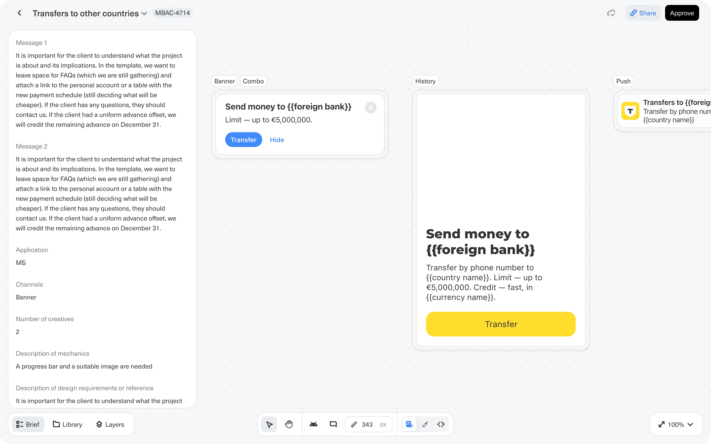
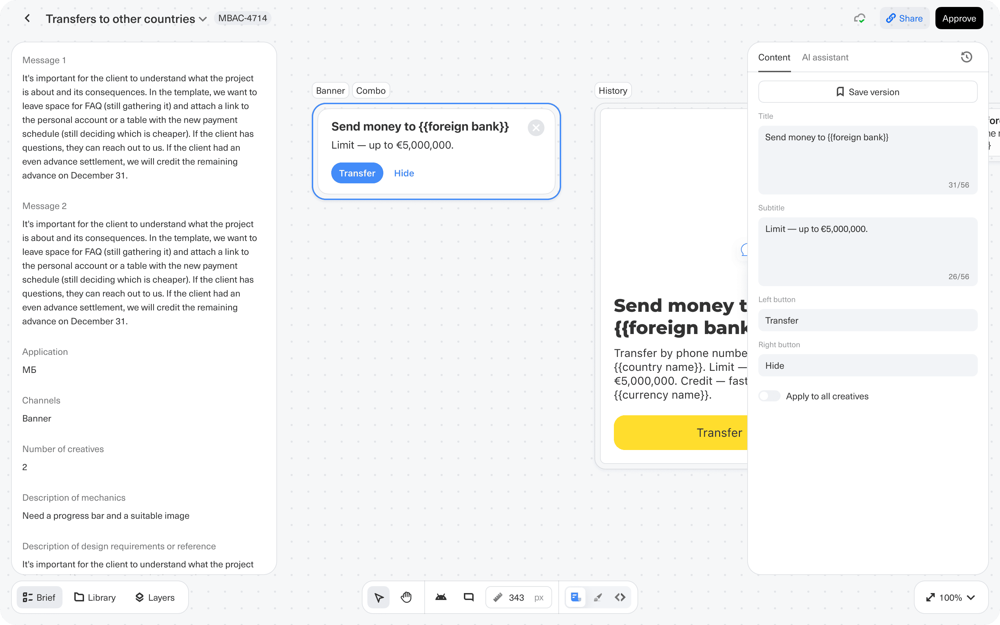
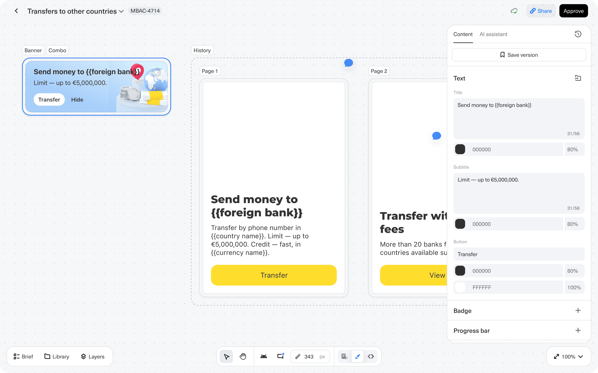
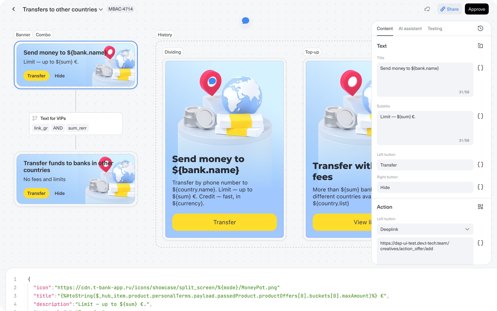
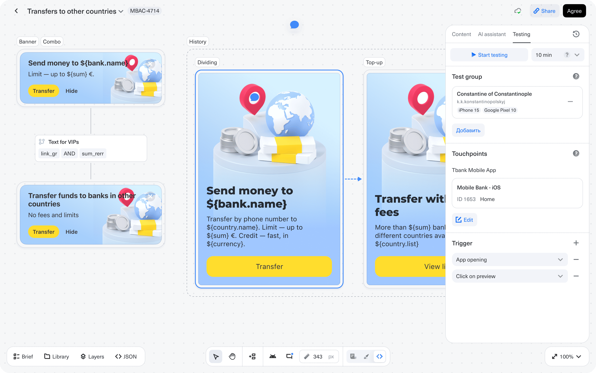

# Touch — Content production

> Source content for [`../../../projects/content-production.html`](../../../projects/content-production.html). Structure follows [`../../../project-page-structure.md`](../../../project-page-structure.md). Slug: `content-production`.

**Lead:** At Tinkoff, content for each channel was made in its own tool: push, SMS and email in one place, banners in another, stories in a third. Together with the section's designer, I shaped Content Hub inside Touch: one canvas where copy editors, designers and technologists create and set up any type of creative. We tested the concept with 25 people in three sessions, one per role.

<!-- FIGURE: Hero - use `00 oreview.png`. Canvas for the Transfers campaign with role tools, AI assistant, and approval controls. -->

*Content Hub canvas: the banner, story and push of one campaign, with the AI assistant and approval controls.*

## Highlights snapshot

| Label | Value |
|-------|-------|
| **◆ Context** | Touch, Tinkoff's internal platform for customer marketing (CVM: customer value management) |
| **◆ Task** | Define the future workflow for content production inside Touch and validate it with copy editors, designers and technologists |
| **◆ Goal** | Cut campaign Time to Market by reducing Time on Task for preparing and approving content across channels |
| **◆ Constraints** | Regulated financial communications; 3 roles in Content Hub: copy editor, designer, technologist; custom and template-based creative formats; transition period with Jira, Figma, chats, and existing constructors |
| **◆ Research** | 3 sessions, 25 people; then product and architecture review |
| **◆ Role** | Lead Product Designer. Took part in research, reviewed design decisions and shaped the vision with Alex, the section's designer. We presented and defended it to stakeholders together |
| **◆ Team** | Product, engineering, content platform |
| **◆ Scope** | Shared creative canvas, role modes, AI assistant, versioning, comments, approval routing, asset library, JSON/substitution tooling, testing setup |
| **◆ Metrics** | _Time on Task for preparing and approving content, as part of campaign Time to Market. No results yet._ |
| **◆ Status** | Vision / discovery |
| **◆ Tools** | Figma, AI |

## Overview

Touch is a platform initiative that brings scattered campaign launch tools into one CVM interface. Content Hub is the content layer of that platform: a place to create, store, manage, version, and analyze every creative used in a campaign.

The concept started from a simple production problem. A single campaign could move through a brief in Jira, copy in Google Docs, design in Figma, layout in a separate constructor, approval in chats, and IDs pasted back into launch tools. Each transfer lost context. The vision was to make the campaign itself the source of truth: the brief, creative previews, comments, approvals, generated variants, assets, templates, JSON, testing, and analytics all stay attached to the same creative.

<!-- FIGURE: `Editors/01.png` - first in-story figure. Shows brief context next to generated creatives. -->

*Copy editor workspace: the brief stays next to the banner, story and push previews, so nobody goes back to Jira or docs for context.*

## Problem

- One campaign's creatives were made in three unconnected tools, depending on the channel.
- Copy editors, designers and technologists worked on the same creative in different places. Each creative went through 1–3 mandatory approval rounds, and context had to be rebuilt at every handoff.
- Review history and decision-making were hard to audit because comments, versions, references, and approvals lived outside the creative.
- Reuse barely worked, although it is one of the main ways to go faster: previous creatives, styles, images, icons, videos and mechanics could not reliably become the starting point for the next campaign.
- AI generation doesn't give reliable quality yet. Generated copy and images still need review and rework, so content production can't be fully automated.

## Approach

We held three sessions, one per role: 8 technologists, 10 designers and 7 copy editors. Then we discussed the concept with product and architecture stakeholders.

The key alignment point was not "everyone uses the same screen." It was "each participant can complete their job in one coherent place." Copy editors need message quality, facts, tone, variants, and optional customer review. Designers need visual control, libraries, resizing, layers, templates, and Figma import. Technologists need JSON, substitutions, actions, deeplinks, triggers, test groups, and bulk testing.

## My role & team

I took part in the research, reviewed design decisions and shaped the vision for the section together with Alex, the designer who owns Content Hub. We presented the concept to stakeholders and defended it together.

| Name | Role | Area | Avatar |
|------|------|------|--------|
| Vova Kirilyuk | Lead Product Designer | Research, design reviews, vision, stakeholder presentations | `../../team/Vova.png` |
| Alex | Product designer | Content Hub owner: content and creatives | `../../team/Alex.png` |

## Key decisions

**Decision 01. One canvas, a mode for each role**

- **Why:** Creatives for different channels were made in different tools, and in the sessions each role described a different job. Copy editors care about tone and facts, designers about visual control, technologists about substitutions, deeplinks and testing.
- **How:** Any type of creative, from a push to a story, opens on the same canvas. Each role switches to its own mode with its own panel. The brief, comments and approval status stay shared.
- **Instead of:** One universal editor with every control for everyone.

**Decision 02. AI drafts, a specialist decides**

- **Why:** Generated copy and images still need review and rework, so content production can't be automated end to end.
- **How:** Each mode has an AI assistant: copy variants for editors, backgrounds and resizing for designers. Every generated version is saved and can be compared. A specialist approves the final creative.
- **Changed after the sessions:** Sending every AI-assisted text back to the customer for re-approval became optional instead of mandatory.

**Decision 03. Figma stays as a way out**

- **Why:** Some creatives are custom work that a built-in editor will not cover.
- **How:** Designers can import finished work from Figma and continue in Content Hub.
- **Instead of:** Forcing every task into the built-in editor.

## Solution

Content Hub opens every creative of a campaign on one canvas. The screens follow one campaign, Transfers to other countries: a banner, a two-page story (History on the screens) and a push. Content Hub creates these creatives from the brief and the campaign scenario. Then the copy editor, the designer and the technologist open the same creatives, each in their own mode.

**Shared context.** Every role works next to the same brief, shown on the editor screen above: the messages, channels, number of creatives and the mechanics the campaign needs. Comments and approval status are shared too.

**Copy editor mode.** The copy editor changes the title, subtitle and buttons in fields next to the preview. One switch applies an edit to every selected creative, so the banner, the story and the push say the same thing. For alternatives, the editor asks the AI assistant, for example for more general options, and every result is saved in the version history. Reviewers leave comments right on the creative. When a customer or partner needs to see the text, they get a link to view and comment.

*Copy editor mode: fields for the title, subtitle and buttons sit next to the brief. “Apply to all creatives” sends one edit to the whole set.*

*AI assistant and version history: the editor asks for more general options, and every version stays in the history for comparison.*

*Comments: a reviewer suggests other wording right on the story, and the thread stays with the creative.*

**Designer mode.** The designer opens the same creatives. Selecting an element on the story shows its position, spacing, fill and effects. The library keeps what was already made for the project: assets, styles, icons, images, video and templates for game mechanics. The layers panel shows the story as pages, containers, text and buttons. The AI assistant changes images on request: here it puts the illustration on a blue background, and the designer decides whether to use it. Custom work can still come in from Figma (Decision 03).

*Designer mode: the selected text block on page 1 of the story gets its own position, spacing, fill and effects.*

*Library: assets made in this project, styles, icons, images, video and templates for game mechanics such as bingo, voting or sudoku.*

*Layers: the story opens as pages, containers, text and buttons, so each element can be edited instead of a flat image.*

*Designer AI assistant: the request “Add a background in blue tones” returns a new version, and the designer decides whether to use it.*

**Technologist mode.** The technologist prepares creatives for delivery in the app. On the banner, the technologist adds a separate text for VIP clients, picked by a segment condition. Substitution generation turns placeholders in the copy into data fields, such as the bank name and the limit, and the JSON view shows what the app will receive. Next come actions: page 1 of the story leads to page 2, and the button opens a deeplink. Last, the testing panel sends the set to a tester’s phones, at a chosen place in the mobile bank and on a chosen trigger.

*Technologist mode: the banner gets a separate version for VIP clients, picked by a segment condition. The copy still has placeholders, and the button already has a deeplink.*

*After substitution generation, placeholders become data fields such as ${bank.name} and ${sum}. The JSON view at the bottom shows what the app receives.*

*Actions: page 1 of the story leads to page 2, and the button opens a deeplink.*

*Testing: the set goes to a tester’s two phones, appears on the mobile bank’s home screen and shows on app opening or a tap on the preview.*

**Content memory.** Once creatives are built, their assets, templates, revisions, generated variants, comments, approval state, campaign linkage and performance metadata become part of Content Hub. This turns production artifacts into reusable product data.

## Impact

The work produced a shared vision for how content production should live inside Touch: not as another isolated tool, but as the campaign's content memory and production workspace.

The validation sessions surfaced concrete product decisions: keep role-specific modes, make AI assistive, preserve Figma import for custom work, support optional external review, plan for role permissions, and test the product with real users before launch. The biggest unresolved risk is product architecture: the UX vision depends on a strong content data model, versioning, template strategy, and integrations with existing systems during the transition period.

The next direction is fewer roles: for some communications, the person who requests the campaign should be able to prepare the content without a handoff.

## Learnings

- A "single workspace" only works when each role still gets its own focused job surface.
- Vision work needs a technical counterpart early. The meetings made the UX target clearer, but also exposed where data model, roles, template architecture, and testing workflows need deeper design.

## Assets in this folder

| File | What it shows | Use on case page |
|------|---------------|------------------|
| `00 oreview.png` | Shared canvas with AI assistant and approval controls | **Hero** |
| `Editors/01.png` | Brief beside creative previews | **Overview** |
| `Editors/02.png` | Editor text fields and apply-to-all | **Solution - Editor mode** |
| `Editors/03.png` | AI-generated copy variants and version history | **Solution - Editor mode** |
| `Editors/04.png` | Anchored comments on creative preview | **Solution - Editor mode** |
| `Designers/01.png` | Designer properties panel | **Solution - Designer mode** |
| `Designers/02.png` | Library with assets, styles, images, videos, objects, templates | **Solution - Designer mode** |
| `Designers/03.png` | Layers panel for structured creative pages | **Solution - Designer mode** |
| `Designers/04.png` | AI assistant for image refinement | **Solution - Designer mode** |
| `Technologists/01.png` | Substitutions and deeplink setup | **Solution - Technologist mode** |
| `Technologists/02.png` | JSON view | **Solution - Technologist mode** |
| `Technologists/03.png` | Navigation/action setup | **Solution - Technologist mode** |
| `Technologists/04.png` | Testing panel | **Solution - Technologist mode** |

## Publishing checklist

- [x] Lead stands alone if someone only reads one sentence
- [x] Snapshot has Task + Goal + Role; Metrics or honest "vision stage"
- [x] At least one figure between Overview and Solution (`Editors/01.png`)
- [x] Problem bullets are specific, not generic
- [x] Solution references what is visible in the screenshots
