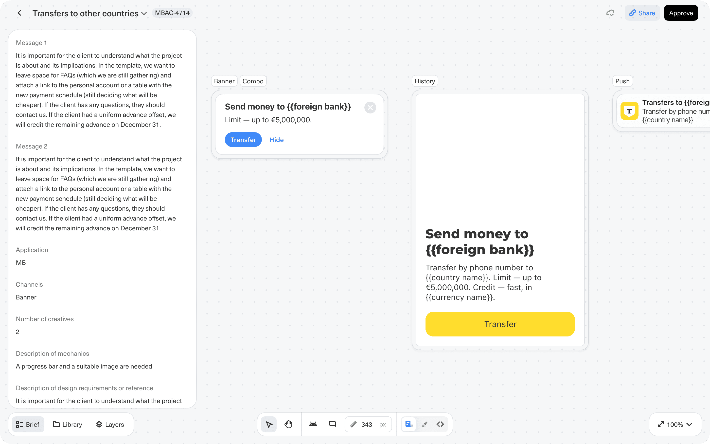
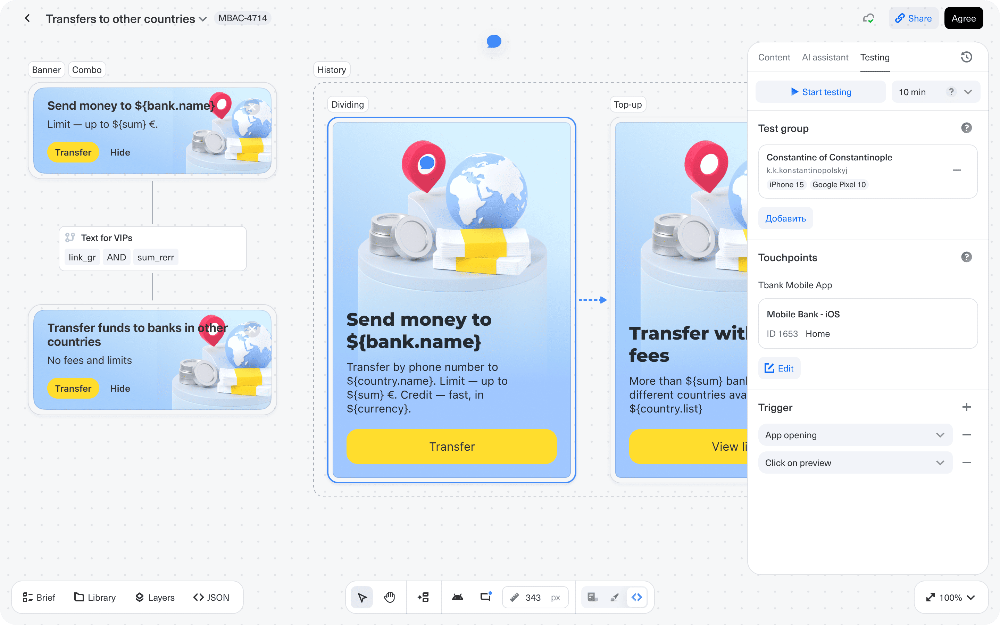
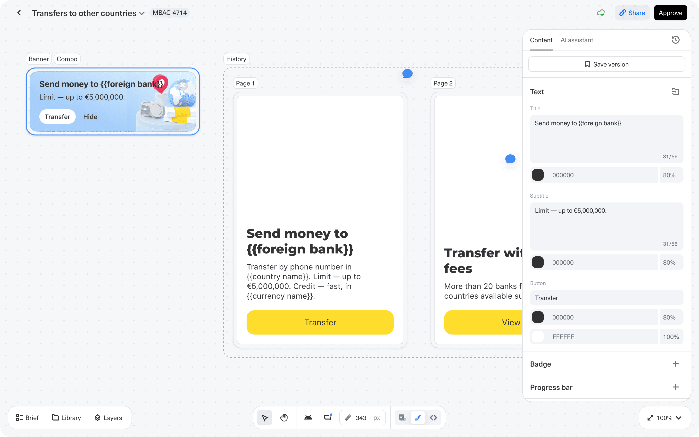
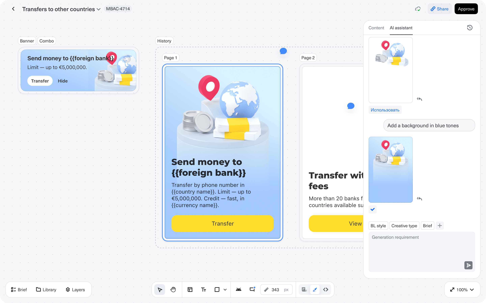
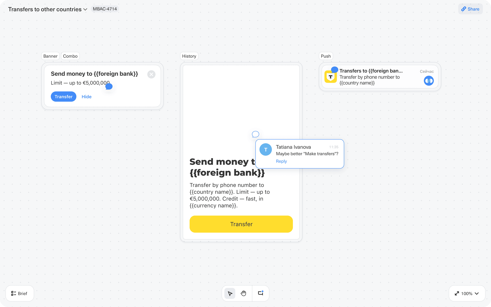

# One workspace, three crafts

> Source content for [`../../../projects/content-production.html`](../../../projects/content-production.html). Structure follows [`../../../project-page-structure.md`](../../../project-page-structure.md). Slug: `content-production`. Rewritten after the critique in [`roast.md`](roast.md).
>
> **`[нужно от тебя: …]`** marks data only the author can provide. On the live page these render as yellow dashed `<mark class="project-todo">` blocks. Replace both here and in the HTML, then delete the markup.

**Client · Domain · Type · Years:** Tinkoff · FinTech · Marketing automation · Web app · 2026 · Vision stage

**Lead:** Editors, designers and technologists build the creatives for every Tinkoff campaign across Jira, Google Docs, Figma, chats and legacy constructors. We designed a vision for Content Hub: one workspace inside Touch with a mode for each role. Before writing any code, we tested it with 19 specialists and the platform stakeholders. `[нужно от тебя: кто вёл концепт и макеты — ты, Алекс или вместе? Под ответ поправить «We designed»]`

*Content Hub for a Transfers campaign. Every creative, from banner to push, sits on one canvas with the brief, comments and approval status.*

## Highlights snapshot

| Label | Value |
|-------|-------|
| **◆ Context** | Touch, Tinkoff's internal platform for customer marketing. This is the layer where creatives are made inside a campaign |
| **◆ Scale** | A large campaign needs ~30 creatives and ~2 weeks of work; partner approval alone takes 2–3 days and several rounds |
| **◆ Validation** | 4 sessions: 19 specialists (5 editors, 7 designers, 7 technologists) plus a session with platform product and architecture leads |
| **◆ My role** | Product Design Lead. `[нужно от тебя: что ты делал сам — направление, постановка, ревью макетов, ведение встреч?]` |
| **◆ Status** | Vision, not shipped. Key points confirmed by users; architecture still open. `[нужно от тебя: что-то уже в работе или запущено?]` |

## Overview

The [Campaign creation](../../../projects/campaign-creation.html) case gave the campaign a home in Touch: one entity that holds the brief, audiences, creatives and A/B tests. This case goes one level deeper. It is about how the creatives inside that campaign get made, and by whom.

Three roles touch every creative. The editor writes the message and checks facts and tone. The designer builds the visual. The technologist adds personalization, deeplinks and triggers, then tests it. Today each of them works in a different tool, and the creative travels between them by hand. `[нужно от тебя: Content Hub — развитие этапа Content из первого кейса или отдельный продукт? Поправить абзац под ответ]`

## Problem

- **One creative, five tools.** A brief in Jira, copy in Google Docs, design in Figma, layout in a separate constructor, approval in chats. Each handoff means rebuilding context, and the history of decisions is lost along the way.
- **Volume is high.** A large campaign needs about 30 creatives and roughly two weeks of work across the three roles.
- **Outside approval is slow.** Partners don't have Tinkoff accounts, so review happens over email and chat. It takes 2–3 days and several rounds.
- **Built-in editors can't cover everything.** Designers estimate 40–60% of their tasks are custom work that no template handles.
- **AI isn't ready to ship on its own.** Designers reported that none of the AI generations they tried went to production without edits.
- **The last attempt failed on usability.** A previous version of Content Hub shipped without user testing. As one technologist put it: it looked fine in Figma and didn't work in real life.

## Approach

We treated the concept as a hypothesis, not a pitch. In February 2026 we showed it to each role separately: 5 editors, 7 designers and 7 technologists. Every session followed the same pattern: walk through the role's own mode, then ask what is missing, what is wrong and what they would never use.

The main finding: people didn't want "everyone on the same screen". They wanted each role to finish its own job without leaving the workspace. That turned the concept from one universal editor into one shared canvas with a mode per role.

In May we brought the updated vision to the platform's product and architecture leads. That meeting is described below, because it changed the plan more than any feature did.

## My role & team

Alex led the concept and the layouts, and presented the vision in every session. `[нужно от тебя: твоя часть. Например: «I set the direction, reviewed the layouts, planned the validation and co-ran the sessions». Если Алекс работал под твоим руководством — так и написать]`

At the stakeholder meeting I defended the role-based model and proposed settling the disputed points with users rather than in a meeting room. `[нужно от тебя: что ещё делал — постановка, синк с продуктом, план поставок?]`

| Name | Role | Area | Avatar |
|------|------|------|--------|
| Vova Kirilyuk | Product Design Lead | `[нужно от тебя: зона ответственности]` | `../../team/Vova.png` |
| Alex | Product designer | Concept, layouts, role sessions | `../../team/Alex.png` |

## Key decisions

### Decision 01 · Confirmed — A mode for each role, not one screen for everyone

- **Why:** The three roles work on the same creative but do completely different jobs. One universal editor would show everyone everything and help no one.
- **How:** One canvas with the campaign brief and all its creatives. On top of it, the editor, designer and technologist each get a mode with only their tools: text fields and versions; layers, library and resize; substitutions, deeplinks and testing.
- **Instead of:** A single all-in-one editor, or three separate tools linked by Jira tickets, as today.
- **Status:** Confirmed by all three role groups. Challenged later by the architecture lead (see below).

*Editor mode. The brief stays beside every preview, so the editor never goes back to Jira to check what the campaign is about.*

*Technologist mode on the same canvas: test group, touchpoints and app triggers for the selected creatives.*

### Decision 02 · Confirmed — Figma stays

- **Why:** 40–60% of design tasks are custom. No built-in editor will cover them, and forcing designers to try would slow them down.
- **How:** The designer mode handles standard work: backgrounds, styles, templates, resizing across formats. For custom work, designers import finished frames from Figma into the creative.
- **Instead of:** Rebuilding Figma inside Touch.

*Designer mode. Visual editing happens next to the same previews and approval status the other roles see.*

### Decision 03 · Changed after research — AI assists, a designer always reviews

- **Why:** None of the AI generations designers had tried went to production without edits. In a regulated bank, an unchecked visual is a risk, not a shortcut.
- **Before:** The early concept had AI generate complete visuals.
- **After:** Full-visual generation is on hold. AI drafts text variants and helps with backgrounds, refinement and resizing. Every AI image goes to a designer for review.

*The AI assistant helps the designer explore and refine a background. The designer decides what ships.*

### Decision 04 · Confirmed, details open — Outside review by link, and only when needed

- **Why:** Partner approval takes 2–3 days and several rounds over email and chat. Partners have no Tinkoff accounts.
- **How:** The editor shares a link with comment access. Feedback lands directly on the creative. Customer re-approval is optional, so a small AI-assisted text fix doesn't trigger a new round.
- **Open:** Access rules for external users are not designed yet.

*Comments are pinned to the creative itself, so the discussion stays with the work instead of in a chat thread.*

## Where the vision was challenged

In May we showed the vision to the platform's product and architecture leads. The architect challenged the core idea: why build a dedicated workspace per role, if most campaigns should eventually run on templates? He compared the vision to a fighter jet whose hardest part, the engine, hadn't been designed: without a content data model, the interface had nothing to stand on.

He was partly right. The data model, versioning and template strategy are the biggest risk of the whole vision. But the role split came from 19 people who do this work every day. Instead of arguing it out in the room, I proposed listing every disputed point and checking each one with users.

The meeting ended without decisions. The compromise everyone accepted: each role should finish all of its work in one interface, and the disputed points get validated with users before anyone builds them.

`[нужно от тебя: что было после 20.05? Спорные точки проверили на пользователях? Рабочая группа собралась? Что из этого вышло?]`

## Outcome

This is a vision, not a launch. The proof is how far the concept was tested, and what changed because of it.

- **Confirmed:** role-based modes on one canvas, Figma import for custom work, optional outside review by link.
- **Changed:** full AI visual generation put on hold; every AI image goes through a designer; editors' experience with partner agencies goes into the brief.
- **Open:** the content data model and versioning, templates vs. branching existing content, role permissions, Jira integration during the transition, and reusing past creatives as "content memory".

`[нужно от тебя: первая поставка — что в неё вошло и когда]`

## Learnings

- **"One workspace" means one place, not one screen.** It works only if each role still gets its own focused surface.
- **AI should take the routine, not the responsibility.** Variants, substitutions and resizing, yes. Skipping a specialist's review, no.
- **A UX vision needs a technical partner from day one.** The interface depends on a data model we hadn't designed with architecture. Next time I'd bring the architect into the first session, not the last.

## Sources

Numbers and quotes come from the meeting transcripts in this folder: `Editors/Editors.txt`, `Designers/Designers.txt`, `Technologists/Technologists.txt` (17.02.2026) and `Вижен КХ.txt` (20.05.2026). `[нужно от тебя: можно ли публично цитировать цифры со встреч?]`

## Assets in this folder

| File | What it shows | Use on case page |
|------|---------------|------------------|
| `00 Preview.png` | Shared canvas with AI assistant and approval controls | **Hero** + home card |
| `Editors/01.png` | Brief beside creative previews | **Decision 01** |
| `Technologists/04.png` | Testing panel | **Decision 01** |
| `Designers/01.png` | Designer properties panel | **Decision 02** |
| `Designers/04.png` | AI assistant for image refinement | **Decision 03** |
| `Editors/04.png` | Anchored comments on creative preview | **Decision 04** |
| `Editors/02.png`, `Editors/03.png`, `Designers/02.png`, `Designers/03.png`, `Technologists/01–03.png` | Other mode details | Not used (cut from 13 to 6 frames after the critique) |
