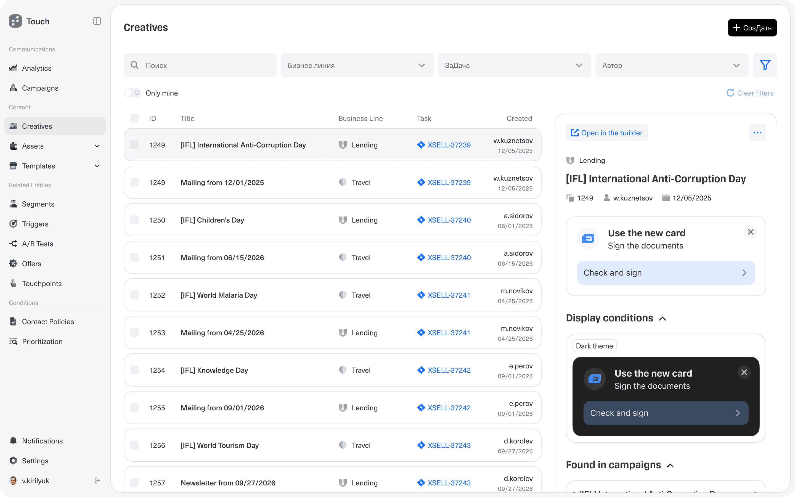
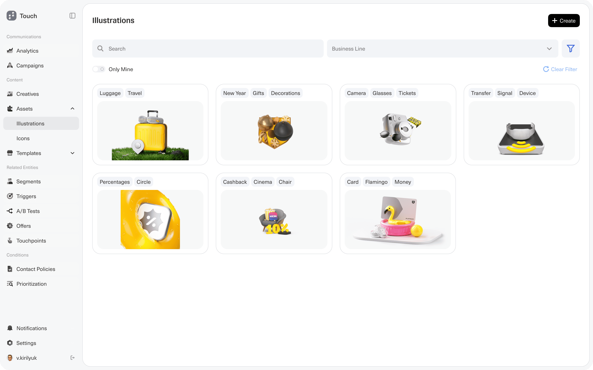
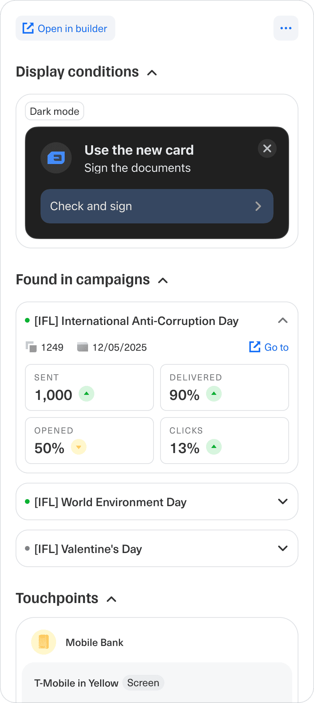
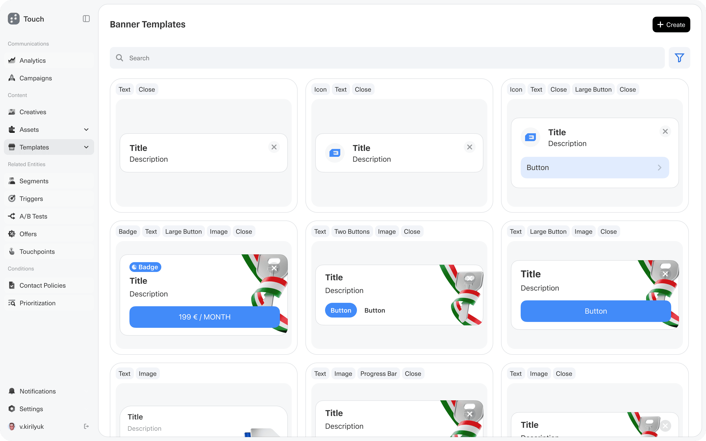

# A library that fills itself

**Client · Domain · Type · Years · Status:** Tinkoff · FinTech · Marketing automation · Web app · 2026 · Live

> Source content for [`../../../projects/content-storage.html`](../../../projects/content-storage.html). Previous version: [`info-v1.md`](info-v1.md). Slug: `content-storage`.

**Lead:** Tinkoff's marketing teams reused creatives by cloning old Jira tasks and digging through a Figma page of templates. Content storage in Touch fills itself when a creative is published, so any creative, illustration, icon or template can be found and traced to its campaigns. Designer Alex led the concept; I reviewed the design, advised on the business process and drew part of the prototypes.

*Creative registry. Pick any creative to see its business line, source task, display conditions and the campaigns it runs in.*

## Highlights snapshot

| Label | Value |
|---|---|
| **◆ Context** | Touch, Tinkoff's internal platform for customer marketing. Storage is where finished creatives and their parts live after production |
| **◆ Research** | Part of the February role sessions with 19 specialists (5 editors, 7 designers, 7 technologists), then a May review with platform product and architecture leads |
| **◆ My role** | Product Design Lead. Design review, business process expertise, part of the prototypes |
| **◆ Status** | Live: creative registry with campaign usage, illustration and icon libraries, template catalog. Not yet: performance per creative and revision history. The template model is still open |

## Overview

[Campaign creation](../../../projects/campaign-creation.html) gave the campaign a home in Touch. [Content production](../../../projects/content-production.html) is where editors, designers and technologists make the creatives inside it. This case is about what happens after: where finished creatives and the pieces they are made of live, and how the next team finds them.

Before storage, the history of a creative was spread across a Jira task, a Figma file and the memory of whoever made it. Reuse worked only if you knew whom to ask.

## Problem

- **Reuse meant cloning.** "We take a finished task, clone it and tweak it a bit." That is how the platform architect described the usual way to reuse content.
- **Templates lived outside the product.** Editors kept a whole Figma page of story templates, and Alex kept it open every day. A team that needed a new layout waited for whoever maintained the constructor.
- **Building blocks had no names.** Ready-made story elements in the constructor had random names, so technologists found them from memory.
- **A second library was about to appear.** The design team already ran a library of validated, tagged illustrations and planned to serve it company-wide. A separate library in Touch would split the source of truth.
- **Overuse was invisible.** Designers asked for a way to see how often a creative had been reused, so the same visual doesn't end up in every campaign.

## Approach

Storage was not a separate track. It was part of every February session with editors, designers and technologists: after walking through their own mode, each role saw the library and told us what they search for and where. Editors and designers had the most to say.

- **Editors** wanted to choose between story layouts with lists, facts and ratings instead of one standard template.
- **Designers** asked us to plug in their validated library instead of building a second one, and to show how often a creative is reused.

In May we brought the concept to the platform's product and architecture leads. Their objections are described below.

## My role & team

Alex led the concept and the layouts, and presented storage in every session. I reviewed the design at each step, advised on how campaign content is actually produced and reused, and drew part of the prototypes myself.

| Name | Role | Area |
|---|---|---|
| Vova Kirilyuk | Product Design Lead | Design review, business process, part of the prototypes |
| Alex | Product designer | Concept, layouts, role sessions |

## Key decisions

### The library fills itself

_Decision 01 · Live_

- **Why.** A library that depends on people uploading and tagging goes stale. Every creative in Touch already carries what tagging needs: the campaign, the scenario, the Jira task, the test group.
- **How.** When a creative is published to a campaign, it lands in storage together with its images and icons, tagged with that metadata. Manual upload stays for assets made outside Touch.
- **Instead of.** A separate asset manager that someone has to fill and keep in order by hand.

*Illustration library. Assets that arrive with a published creative are already tagged by campaign and business line, so search and filters work without manual tagging.*

### Every creative answers "where is this used?"

_Decision 02 · Live, metrics next_

- **Why.** A creative can run in several campaigns and touchpoints at once. Before changing or reusing it, people need to see all of them.
- **How.** A creative is a record, not a picture. Its panel shows display conditions, including the dark theme, the campaigns that use it and the touchpoints where it appears, with a link back to the builder.
- **Instead of.** A gallery of previews, where finding usage means asking around.
- **Status.** Usage is live. Performance per creative is not: the architecture team wants analytics to live outside the content system (see below).

*Creative panel from the concept. The live version shows conditions, campaigns and touchpoints. The metric cards are a later step.*

### One library with the design team, not two

_Decision 03 · Changed after research_

- **Why.** The design team already curates validated, tagged illustrations and plans to serve them company-wide. A second library in Touch would compete with theirs.
- **Before.** The concept had Touch build its library only from its own creatives.
- **After.** One-way sync. Validated images flow from the design team's library into Touch, and nothing flows back. Touch adds what comes from its own published creatives.

### Template or branch?

_Decision 04 · Open_

- **Why.** Editors and technologists need starting points, so they don't rebuild common layouts or wait for the constructor team.
- **Live.** A catalog of banner templates that shows each layout's structure: text, icon, buttons, badge, image, progress bar.
- **Alternative.** The platform architect argued that templates don't need to be a separate object. Any creative can be marked as a favourite and branched, and the history of who changed what comes for free.
- **Open.** The two answer different needs: a catalog gives structure, branching reuses proven content. Which model holds the data is not decided yet.

*Template catalog. The labels above each layout let an editor pick by structure, for example a card with an image and one large button, before any copy exists.*

## Where the concept was challenged

In May the platform architect pushed back on three points. Content needs a master system with versions and revisions, where anyone can see who changed what and what it was branched from. Templates don't need to be a separate entity. And analytics doesn't belong in the content system at all, apart from unique IDs for each piece of content and its variants.

Versions and revisions are not in storage yet. On analytics, the first version shows usage, not performance. On templates, the catalog shipped because teams needed it, but the data model behind it is still open. Instead of settling this in the room, I proposed listing every disputed point and checking each one with users.

## Outcome

- **Live:** creative registry with campaign usage and touchpoints, illustration and icon libraries that fill themselves from published creatives, template catalog.
- **Changed after research:** one-way sync with the design team's library instead of a second library.
- **Open:** template entity or branching, revision history, performance per creative, a reuse counter that designers asked for.

## Learnings

- **A library stays alive only if filling it costs nothing.** Metadata from the campaign does the tagging that people never get around to.
- **Don't build a second library next to a working one.** The design team already owned validated illustrations. Syncing with them was cheaper than competing with them.
- **Agree on what a word means before arguing about it.** To an editor a template is a layout; to an architect it can be a branch of old content. Naming both turns the dispute into a concrete question.

## Assets in this folder

| File | What it shows | Use on case page |
|---|---|---|
| `01.png` | Creative registry with detail panel | **Hero**, home card |
| `02.png` | Creative panel concept: conditions, campaigns, metrics, touchpoints | Decision 02 (metric cards not live) |
| `03.png` | Illustration library | Decision 01 |
| `05.png` | Banner template catalog | Decision 04 |
| `04.png` | Icon library | Not used |
| `00 Preview.png` | Same file as `03.png` | Not used |

## Known issues in the screenshots

- `01.png`: two rows share ID 1249; filters mix Russian (Поиск, Бизнес линия, Создать) with English UI.
- `01.png` says "Dark theme" and "Open in the builder", `02.png` says "Dark mode" and "Open in builder".
