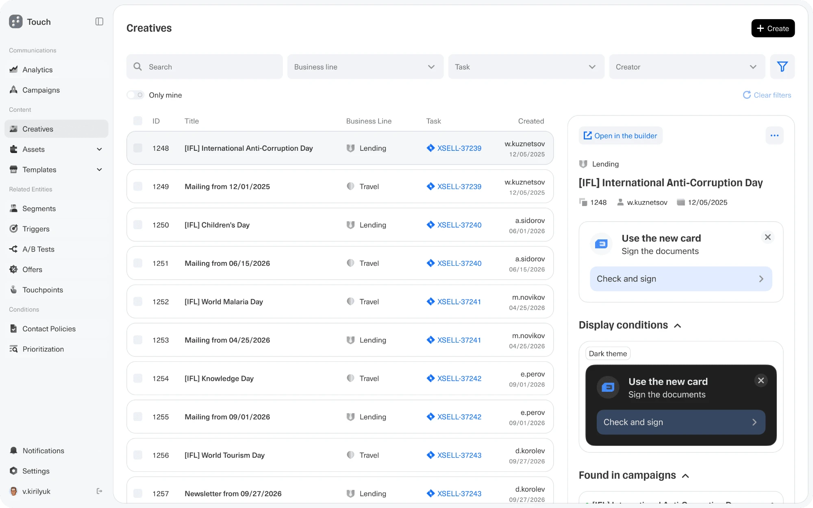
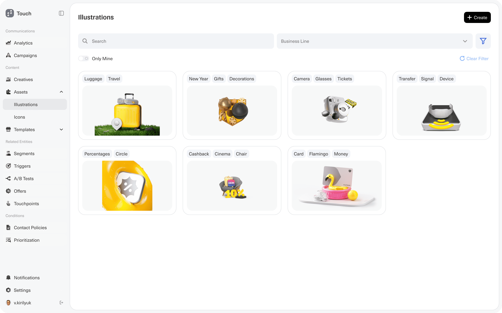
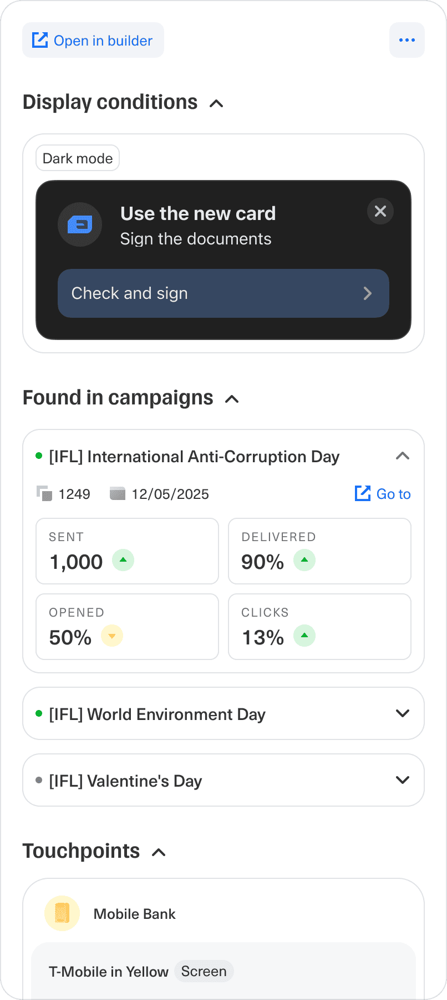
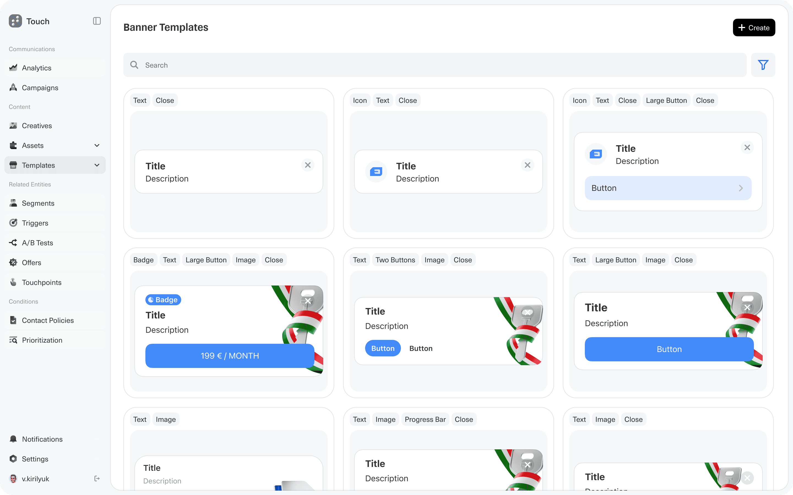

# A library that fills itself

> Source content for [`../../../projects/content-storage.html`](../../../projects/content-storage.html). Previous version: [`info-v1.md`](info-v1.md). Slug: `content-storage`.

**Lead:** At Tinkoff, marketing teams make hundreds of creatives every month, and after launch they get lost in old Jira tasks and Figma files. To reuse one, people clone a past task or search a Figma page of templates. Together with the section's designer, I shaped Content storage inside Touch: a library that fills itself as creatives are published, so any creative can be found, reused and traced to the campaigns it ran in. The direction is agreed and comes next after Content Hub.

*Creative registry. Pick any creative to see its business line, source task, display conditions and the campaigns it runs in.*

## Highlights snapshot

| Label | Value |
|---|---|
| **◆ Context** | Touch, Tinkoff's internal platform for customer marketing, where teams produce hundreds of creatives every month. Storage is where finished creatives and their parts live after production |
| **◆ Goal** | One place to store and reuse content and to see how well it performs. Target: less Time on Task for picking graphic and text creatives |
| **◆ Research** | Library and templates shown in role sessions with 8 technologists, 10 designers and 7 copy editors; the full storage concept reviewed with platform product and architecture leads |
| **◆ My role** | Lead Product Designer. Research, design reviews, shared vision and stakeholder defense with the section's designer, part of the prototypes |
| **◆ Status** | Agreed direction, planned after Content production. Not built yet. The template model is still open |

## Overview

[Campaign creation](../../../projects/campaign-creation.html) gave the campaign a home in Touch. [Content production](../../../projects/content-production.html) is where editors, designers and technologists make the creatives inside it. This case is about what happens after: where finished creatives and the pieces they are made of live, and how the next team finds them.

Teams produce hundreds of creatives every month. Today the history of each one is spread across a Jira task, a Figma file and the memory of whoever made it. Reuse works only if you know whom to ask.

## Problem

- **Reuse means cloning.** "We take a finished task, clone it and tweak it a bit." That is how the platform architect described the usual way to reuse content.
- **Templates live outside the product.** Editors keep a whole Figma page of story templates, and even the section's designer works from it every day. A team that needs a new layout waits for whoever maintains the constructor.
- **Building blocks have random names.** Ready-made story elements in the constructor are hard to find, because nobody agreed on their names.
- **A second library is about to appear.** The design team already runs a library of validated, tagged illustrations and plans to serve it company-wide. A separate library in Touch would split the source of truth.
- **Overuse is invisible.** Designers asked for a way to see how often a creative has been reused, so the same visual doesn't end up in every campaign.

## Approach

The library and templates were part of the Content production sessions with each role: 8 technologists, 10 designers and 7 copy editors. Alex showed how the library fills itself from published creatives and where templates live. Editors and designers had the most to say.

- **Editors** wanted to choose between story layouts with lists, facts and ratings instead of one standard template.
- **Designers** asked us to plug in their validated library instead of building a second one, and to show how often a creative is reused.

The full storage concept, with the creative registry and usage panel, was then reviewed with the platform's product and architecture leads. They agreed on the direction and raised objections, described below.

## My role & team

I took part in the research, reviewed design decisions and shaped the vision for storage together with Alex, the designer who owns the section. Alex drew the layouts and showed the library in each role session. I brought in how campaign content is actually produced and reused, and drew part of the prototypes myself. We presented the full concept to stakeholders and defended it together. When the architecture review stalled on templates and analytics, I proposed listing every disputed point and checking each one with users.

| Name | Role | Area |
|---|---|---|
| Vova Kirilyuk | Lead Product Designer | Research, design reviews, vision, stakeholder presentations, part of the prototypes |
| Alex |  | Section owner: layouts, role sessions |

## Key decisions

### The library fills itself

_Decision 01 · Agreed_

- **Why.** A library that depends on people uploading and tagging goes stale. Every creative in Touch already carries what tagging needs: the campaign, the scenario, the Jira task, the test group.
- **How.** When a creative is published to a campaign, it lands in storage together with its images and icons, tagged with that metadata. Manual upload stays for assets made outside Touch.
- **Instead of.** A separate asset manager that someone has to fill and keep in order by hand.

*Illustration library. Each asset carries subject tags and a business line, so a designer finds it with search and filters instead of scrolling a Figma page.*

### Every creative answers "where is this used?"

_Decision 02 · Agreed, metrics later_

- **Why.** A creative can run in several campaigns and touchpoints at once. Before changing or reusing it, people need to see all of them.
- **How.** A creative is a record, not a picture. Its panel shows display conditions, including the dark theme, the campaigns that use it and the touchpoints where it appears, with a link back to the builder.
- **Instead of.** A gallery of previews, where finding usage means asking around.

*Creative panel from the concept. The first version will show conditions, campaigns and touchpoints; the metric cards come later.*

### One library with the design team, not two

_Decision 03 · Changed after research_

- **Why.** The design team already curates validated, tagged illustrations and plans to serve them company-wide. A second library in Touch would compete with theirs.
- **Before.** The concept had Touch build its library only from its own creatives.
- **After.** One-way sync. Validated images flow from the design team's library into Touch, and nothing flows back. Touch adds what comes from its own published creatives.

### Template or branch?

_Decision 04 · Open_

- **Why.** Editors and technologists need starting points, so they don't rebuild common layouts or wait for the constructor team.
- **Concept.** A catalog of banner templates that shows each layout's structure: text, icon, buttons, badge, image, progress bar.
- **Alternative.** The platform architect argued that templates don't need to be a separate object. Any creative can be marked as a favourite and branched, and the history of who changed what comes for free.
- **Open.** The two answer different needs: a catalog gives structure, branching reuses proven content. Which model holds the data is not decided yet.

*Template catalog. The labels above each layout let an editor pick by structure, for example a card with an image and one large button, before any copy exists.*

## Where the concept was challenged

At that review, the platform architect pushed back on three points. Content needs a master system with versions and revisions, where anyone can see who changed what and what it was branched from. Templates don't need to be a separate entity. And analytics doesn't belong in the content system at all, apart from unique IDs for each piece of content and its variants.

Versions and revisions are not in the concept yet. On analytics, the data can live wherever the platform needs it; the interface still shows performance inside storage, starting with usage in the first version. On templates, the catalog stays in the concept because teams need starting points, but the data model behind it is still open. Instead of settling this in the room, I proposed listing every disputed point and checking each one with users.

## Outcome

- **Agreed:** creative registry with campaign usage and touchpoints, illustration and icon libraries that fill themselves from published creatives, and a template catalog. Stakeholders and the team approved the direction; building starts after Content production.
- **Changed after research:** one-way sync with the design team's library instead of a second library.
- **Open:** template entity or branching, revision history, performance per creative, a reuse counter that designers asked for, and testing the full concept with users.

## Learnings

- **A library stays alive only if filling it costs nothing.** Metadata from the campaign does the tagging that people never get around to.
- **Don't build a second library next to a working one.** The design team already owned validated illustrations. Syncing with them is cheaper than competing with them.
- **Agree on what a word means before arguing about it.** To an editor a template is a layout; to an architect it can be a branch of old content. Naming both turns the dispute into a concrete question.

## Assets in this folder

| File | What it shows | Use on case page |
|---|---|---|
| `01.webp` | Creative registry with detail panel (Russian labels removed, IDs fixed) | **Hero**, home card |
| `01.png` | Previous version of the registry screen | Archived page `content-storage-v1.html` only |
| `02.png` | Creative panel concept: conditions, campaigns, metrics, touchpoints | Decision 02 (metric cards later) |
| `03.png` | Illustration library | Decision 01 |
| `05.png` | Banner template catalog | Decision 04 |
| `04.png` | Icon library | Not used |
| `00 Preview.png` | Same file as `03.png` | Not used |

## Known issues in the screenshots

- `01.webp` says "Dark theme" and "Open in the builder", `02.png` says "Dark mode" and "Open in builder".
